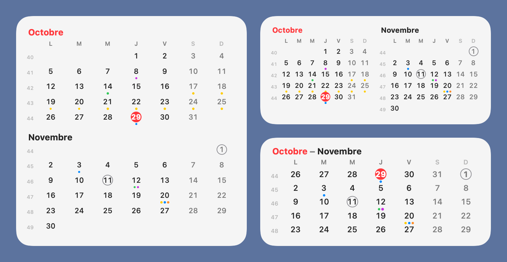

# Deux mois

Widgets macOS pour voir d'un coup d'œil quel jour tombe une date, même en fin de mois.

Le widget Calendrier d'Apple n'affiche que le mois en cours : le 29, on ne voit pas la semaine qui suit. **Deux mois** affiche le mois en cours et le suivant, et **Cinq semaines** la semaine en cours et les quatre suivantes.



## Fonctionnalités

- **Deux mois** : tailles moyenne, grande et très grande.
- **Cinq semaines** : tailles petite, moyenne et grande.
- Jour actuel en rouge, week-ends grisés, numéros de semaine.
- Jours fériés français entourés en gris (y compris Pâques, Ascension et Pentecôte).
- Un point de couleur sous chaque jour qui a un événement, de la couleur de son calendrier (3 au maximum). Un calendrier dont le nom contient « famil » (Famille, Familial…) est toujours affiché en jaune et en premier.
- Fonctionne sur le bureau et dans le Centre de notifications (sauf la très grande taille, réservée au bureau).
- Interface en français, semaine commençant le lundi.

## Installation rapide (.dmg)

1. Téléchargez `DeuxMois-<version>.dmg` dans les [Releases](../../releases).
2. Ouvrez-le et glissez **DeuxMois** dans **Applications**.
3. Ouvrez l'app. macOS la bloque la première fois : elle n'est pas notarisée par Apple (il faudrait un compte développeur payant). Allez dans Réglages Système > Confidentialité et sécurité, puis cliquez sur « Ouvrir quand même » en face de DeuxMois.
4. Autorisez l'accès au Calendrier, puis ajoutez les widgets (clic droit sur le bureau > « Modifier les widgets… »).

L'app est universelle (Apple Silicon et Intel) et signée sans identité de développeur. Après chaque mise à jour, macOS peut redemander l'accès au Calendrier. Si vous préférez ne pas faire confiance à un binaire téléchargé, compilez-la vous-même (ci-dessous) : le résultat est le même.

## Compiler soi-même

Prérequis : macOS 14 ou plus récent, [Xcode](https://apps.apple.com/app/xcode/id497799835) et [XcodeGen](https://github.com/yonaskolb/XcodeGen) (`brew install xcodegen`).

1. Dans Xcode, connectez votre compte Apple (Xcode > Réglages > Comptes). Un compte gratuit suffit.
2. Copiez la configuration locale et remplissez-la :

   ```bash
   cp Config/Local.xcconfig.example Config/Local.xcconfig
   ```

   - `DEVELOPMENT_TEAM` : l'identifiant de votre équipe (10 caractères), visible dans Xcode > Réglages > Comptes.
   - `BUNDLE_ID_PREFIX` : un préfixe qui vous est propre, par exemple `com.votrepseudo`.

   Ce fichier reste sur votre Mac : il est exclu du dépôt.
3. Lancez l'installation :

   ```bash
   ./install.sh
   ```

   Le script compile l'app, l'installe dans `/Applications`, l'ouvre, puis relance les services système qui affichent les widgets pour qu'ils prennent la nouvelle version.
4. À la première ouverture, autorisez l'accès au Calendrier (sinon les widgets s'affichent sans les points d'événements).
5. Clic droit sur le bureau > « Modifier les widgets… », puis cherchez « Deux mois » ou « Cinq semaines ».

Pour mettre à jour après une modification du code, relancez `./install.sh`. Si un widget n'a pas changé, retirez-le puis remettez-le.

## Confidentialité

- **Rien ne quitte votre Mac.** L'app et le widget tournent dans le bac à sable de macOS, sans accès réseau.
- Le seul accès demandé est la **lecture** de vos calendriers. Rien n'y est jamais modifié.
- Seules la date et la couleur du calendrier de chaque événement sont utilisées. Les titres, lieux et notes ne sont ni affichés, ni enregistrés, ni journalisés.
- Aucune statistique, aucun suivi, aucune dépendance externe dans l'app.

Vous pouvez retirer l'accès à tout moment dans Réglages Système > Confidentialité et sécurité > Calendriers.

## Désinstallation

Retirez les widgets, puis supprimez `/Applications/DeuxMois.app`.

## Structure du code

- `Shared/CalendarViews.swift` : l'affichage des mois et des semaines.
- `Shared/CalendarData.swift` : jours fériés, lecture des événements.
- `Widget/DeuxMoisWidget.swift` : les deux widgets et leur rafraîchissement.
- `App/DeuxMoisApp.swift` : la petite app qui porte les widgets et demande l'accès au Calendrier.
- `project.yml` : description du projet pour XcodeGen (le `.xcodeproj` est généré).
- `tools/make-icon.swift` : dessine l'icône et génère toutes ses tailles (`swift tools/make-icon.swift App/Assets.xcassets/AppIcon.appiconset`).
- `install.sh` : compile et installe sur votre Mac. `release.sh` : fabrique le `.dmg` publié, signé sans identité, et refuse de le produire s'il contient une donnée personnelle.

## Licence

[MIT](LICENSE)
